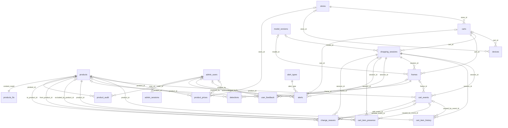

# ฐานข้อมูล SQLite

ไฟล์: `db/smartcart.db` (ไม่ commit) · สร้างจากศูนย์ด้วย

```powershell
npm install
npm run db:init   # รัน db/migrations/*.sql ที่ยังไม่เคยรัน บันทึกใน schema_migrations
npm run db:seed   # สินค้า 20 รายการ, ราคา, สาขา, รถเข็น 17 คัน, โมเดล 10 รุ่น, บัญชี admin
```

ทั้งสองคำสั่งรันซ้ำได้ (idempotent) และ server จะรัน seed ทุกครั้งที่ start

## กติกา

- ทุก connection ตั้ง `journal_mode=WAL`, `foreign_keys=ON`, `busy_timeout=5000` (`server/src/db/connection.js`)
- คอลัมน์ `*_ms` = epoch milliseconds จากนาฬิกา **server** ส่วน `created_at` / `updated_at` เป็นเวลา audit แบบ TEXT (UTC)
- `frames.t_capture_device_ms` เป็นนาฬิกามือถือ ใช้ดูอย่างเดียว ห้ามลบกับเวลา server; `frames.e2e_ms` วัดบนมือถือเครื่องเดียวกัน
- ห้ามแก้ไฟล์ migration ที่รันแล้ว (runner ตรวจ checksum) ให้เพิ่มไฟล์ใหม่แทน
- migration ที่ขึ้นต้นด้วย `-- requires: fts5_trigram` จะถูกข้ามถ้า SQLite ไม่รองรับ (การค้นหาจะ fallback เป็น `LIKE`) — better-sqlite3 ที่ใช้อยู่มากับ SQLite 3.53 รองรับแล้ว

## Migrations

| ไฟล์ | เนื้อหา |
| --- | --- |
| `001_init.sql` | `stores`, `carts`, `devices`, `products`, `product_prices` (SCD2), `model_versions`, `admin_users`, `shopping_sessions`, `cart_events`, `cart_item_history` (SCD2 จำนวนต่อสินค้า), `frames`, `detections`, `user_feedback`, `alert_types`, `alerts` และ view `v_product_abandon`, `v_cooccurrence`, `v_frame_latency` |
| `002_presence_reasons.sql` | attribute สินค้า (`product_line`, `flavor`, `variant`, `sub_category`, `in_model`), บาร์โค้ด unique, `frames.e2e_ms`, alert type ใหม่, `cart_item_presence` (SCD2 รายชิ้น), `change_reasons`, `product_audit`, `job_runs`, `v_change_reason_summary` |
| `003_products_fts.sql` | `products_fts` (FTS5 trigram สำหรับชื่อไทย) + trigger sync กับ `products` |
| `004_align_instruction.sql` | เติมส่วนที่ 001 ขาดเมื่อเทียบกับ instruction ภาค 2 หัวข้อ 2.7 (ดูตารางด้านล่าง) |
| `005_admin_sessions.sql` | `admin_sessions` — session login ของหน้า admin (เก็บ HMAC ของ session id, หมดอายุแบบเลื่อน) |

## การตัดสินใจที่ควรรู้

- `001_init.sql` ออกแบบจากรายชื่อตารางใน brief ก่อนได้ instruction ภาค 2 — ส่วนที่ต่างจากหัวข้อ 2.7 สรุปไว้ในหัวข้อถัดไป
- `alert_type` เก็บเป็นตาราง lookup (`alert_types`) แทน `CHECK` เพื่อให้ migration ถัดไปเพิ่มประเภทได้โดยไม่ต้อง rebuild ตาราง
- รถเข็น active ได้ครั้งละ 1 session (`ux_sessions_active_cart`), โมเดล active ได้ครั้งละ 1 รุ่น (`ux_model_active`)
- `products.in_model` คำนวณจาก `model.names` ของโมเดลที่ active (จาก `/health` ของ inference ถ้ารันอยู่ ไม่งั้นใช้ `model_versions.class_names`) — เปลี่ยน weights เป็น 20 คลาสแล้วไม่ต้องแก้โค้ด
- seed ไม่ทับสิ่งที่ admin แก้: สินค้าที่มีแถวใน `product_audit` และราคาที่มี `created_by` จะไม่ถูก CSV เขียนทับ; โมเดลที่ admin เลือกไว้ไม่ถูกเปลี่ยนกลับ; รหัสผ่านที่มีอยู่แล้วไม่ถูก reset
- `model_versions.weights_path` เป็น path สัมพัทธ์กับ `WEIGHTS_ROOT` (โฟลเดอร์ SNP แบบอ่านอย่างเดียว)

## เทียบกับ instruction ภาค 2 หัวข้อ 2.7

ต้นฉบับ: [instruction_part2.md](instruction_part2.md) · instruction ระบุเองว่า "ถ้าขัดกับ brief ให้ยึด brief"
**ตั้งใจ** = คงของเราไว้พร้อมเหตุผล · **พลาด** = แก้แล้วใน `004_align_instruction.sql` (ไม่แก้ไฟล์ที่รันไปแล้ว)

### กติกาที่ใช้กับทุกตาราง (ตั้งใจ)

- **เวลาของเหตุการณ์เป็น `*_ms` INTEGER (epoch ms นาฬิกา server)** แทน TEXT ที่ instruction ใช้กับ `started_at`, `ended_at`, `valid_from`, `valid_to`, `last_seen_at` และ `created_at` ของ feedback/alert — เพื่อลบ/เทียบกับเวลาใน `frames` และ `cart_events` ได้ตรง ๆ (ราคา ณ เวลา ADD, ระยะเวลา session, dwell time, alert ระหว่างเฟรม) ส่วนเวลา audit (`created_at`) ยังเป็น TEXT `CURRENT_TIMESTAMP` เหมือน instruction
- instruction ใช้ไฟล์เดียว `db/schema.sql` — ของเราแยกเป็น migration ที่ตรวจ checksum เพื่อแก้ schema ได้โดยไม่ต้องลบฐานข้อมูล
- ชื่อ PK/FK เป็น `<ตาราง>_id` แบบสั้น (`model_id` แทน `model_version_id`) ให้ชื่อ FK ตรงกับคอลัมน์ที่อ้างถึง

### รายตาราง

| ตาราง / คอลัมน์ | instruction 2.7 | ของเรา | ตั้งใจ / พลาด | เหตุผล หรือการแก้ |
| --- | --- | --- | --- | --- |
| `stores.name`, `branch_code` | `name`, `branch_code` | `name_th`, `code` | ตั้งใจ | ชื่อ; `name_th` ให้เหมือน `products.name_th` |
| `stores.timezone` | มี (`Asia/Bangkok`) | ไม่มี | **พลาด** | เพิ่มแล้ว — job รายวัน 02:00 และสรุปรายวันต้องรู้เขตเวลา |
| `devices` ↔ `carts` | `carts.device_id` → devices | `devices.cart_id` → carts | ตั้งใจ | รถเข็น 1 คันมีได้หลายอุปกรณ์ (กล้อง + จอลูกค้า) |
| `devices.store_id` | มี | ไม่มี | **พลาด** | เพิ่มแล้ว + เติมค่าจาก cart; อุปกรณ์ที่ยังไม่ผูกรถเข็นก็ยังรู้สาขา |
| `devices.device_type` | phone / raspberry_pi (ฮาร์ดแวร์) | camera / display (บทบาท) | ตั้งใจ | ระบบต้องแยกบทบาท; ชนิดฮาร์ดแวร์ดูจาก `user_agent` + `camera_desc` |
| `devices.camera_desc`, `app_version` | มี | ไม่มี | **พลาด** | เพิ่มแล้ว — ต้องบันทึกคู่กับผลทดลอง latency |
| `devices.registered_at`, `last_seen_at` | TEXT | `created_at`, `last_seen_ms` | ตั้งใจ | ชื่อ / ชนิดเวลา (ตรวจ DISCONNECTED เทียบกับเวลาเฟรม) |
| `devices.token_hash`, `label`, `is_active` | — | มี | ตั้งใจ | token ยืนยันมือถือที่เป็นกล้อง (brief หัวข้อ 9) |
| `carts.label` | ว่างได้ | NOT NULL UNIQUE | ตั้งใจ | ใช้ใน URL `/ws/device/{cart}` และ QR |
| `carts.status` | active / maintenance | available / in_use / offline / maintenance | ตั้งใจ | `available` = `active` ของ instruction; `in_use` ตั้งตอนเปิด/ปิด session (หน้า C-09 "รถเข็นถูกใช้อยู่") |
| `carts.qr_code`, `created_at`, `updated_at` | — | มี | ตั้งใจ | payload ของ QR บนด้ามจับ |
| `products.weight_g` | มี | ไม่มี | **พลาด** | เพิ่มแล้ว + seed จากคอลัมน์ Volumn(gram) ใน xlsx (น้ำหนักสุทธิตามฉลาก ไม่ใช่น้ำหนักรวมบรรจุภัณฑ์) |
| `products.image_url` | URL | `image_path` (สัมพัทธ์กับ `web/`) | ตั้งใจ | ใช้ใน LAN ที่ไม่มีอินเทอร์เน็ต |
| `products.sku` | ไม่ unique | UNIQUE | ตั้งใจ | กันข้อมูลซ้ำ |
| `products` attribute อื่น | — | `name_en`, `product_line`, `flavor`, `variant`, `sub_category`, `in_model`, `updated_at` | ตั้งใจ | reason engine (brief หัวข้อ 7) และรองรับ 20 คลาส |
| `product_prices.store_id` | มี | ไม่มี | **พลาด** | เพิ่มแล้ว (NULL = ทุกสาขา); unique ราคาปัจจุบันเปลี่ยนเป็น `(product_id, COALESCE(store_id,0))` |
| `product_prices.valid_from`, `valid_to` | TEXT | `valid_from_ms`, `valid_to_ms` | ตั้งใจ | ชนิดเวลา — เลือกราคา ณ เวลา ADD จาก `cart_events.occurred_at_ms` |
| `product_prices.is_current`, `created_by`, CHECK ราคา | — | มี | ตั้งใจ | SCD2 หาแถวปัจจุบันเร็ว, รู้ว่าใครแก้, promo < price |
| `model_versions.model_version_id`, `yolo_family`, `deployed_at` | ชื่อนี้ | `model_id`, `family`, `activated_at` | ตั้งใจ | ชื่อ |
| `model_versions.imgsz` | มี | ไม่มี | **พลาด** | เพิ่มแล้ว (ค่าเริ่ม 640) — เป็นปัจจัยใน matrix latency หัวข้อ 3.2 |
| `model_versions` metrics | — | `class_names`, `map50_95`, `latency_p95_ms`, `params`, `gflops` | ตั้งใจ | หน้า "โมเดล" และ `in_model` |
| `shopping_sessions.store_id` | มี | ไม่มี | ตั้งใจ | หาได้จาก `carts.store_id` (เก็บที่เดียว ไม่ซ้ำซ้อน) — ไม่ต้องแก้ตารางนี้ |
| `shopping_sessions.started_at`, `ended_at` | TEXT | `started_at_ms`, `ended_at_ms` | ตั้งใจ | ชนิดเวลา (ระยะเวลา session, เทียบกับ event) |
| `shopping_sessions.model_version_id` | ชื่อนี้ | `model_id` | ตั้งใจ | ชื่อ |
| `shopping_sessions` อื่น | — | `pdpa_consent`, `gender`, `age_range`, `checkout_code`; 1 session active ต่อรถเข็น | ตั้งใจ | หน้า C-02/C-03/C-04/C-07 ของ prototype |
| `cart_events.event_type` | ADD / REMOVE / CORRECTION / CHECKOUT | + START / ABANDONED / TIMEOUT | ตั้งใจ | timeline ใน prototype แสดงเหตุการณ์เหล่านี้ |
| `cart_events.confidence_avg` | ชื่อนี้ | `confidence` | **พลาด** | rename แล้ว — ค่าเป็นค่าเฉลี่ยในหน้าต่าง tracker ชื่อเดิมสื่อผิด |
| `cart_events.occurred_at_ms` | ชื่อนี้ | `t_ms` | **พลาด** | rename แล้ว — ชื่อเดิมกำกวม |
| `cart_events.evidence_frame_id` | ไม่มี FK | `frame_id` มี FK | ตั้งใจ | ชื่อตามคอลัมน์ที่อ้างถึง + FK กันข้อมูลกำพร้า |
| `cart_events` อื่น | — | `qty_after`, `local_track_id`, `note`, CHECK `source` | ตั้งใจ | timeline และ presence |
| `cart_item_history` | — | เหมือนกัน (+ CHECK `qty >= 0`) | ตรงกัน | index ชื่อ `ux_item_history_current` |
| `frames.session_id` | ว่างได้ | NOT NULL | ตั้งใจ | brief: ไม่เขียน DB เมื่อรถเข็นไม่มี session |
| `frames.t_capture_ms` | INTEGER | `t_capture_device_ms` REAL | ตั้งใจ | ชื่อเตือนว่าเป็นนาฬิกา device; `performance.now()` เป็นทศนิยม |
| `frames.rtt_ms` | มี | ไม่มี (มีแค่ `e2e_ms`) | **พลาด** | เพิ่มแล้ว — RTT = ส่ง→ack, E2E = ส่ง→`cart_update` ใช้แยกเวลาเครือข่าย |
| `frames.num_detections` | มี | ไม่มี | **พลาด** | เพิ่มแล้ว — ยังใช้ได้หลัง retention ลบ `detections` |
| `frames.image_bytes` | ชื่อนี้ | `jpeg_bytes` | ตั้งใจ | ชื่อ |
| `frames` อื่น | — | `cart_id`, `model_id`, `infer_ms`, `error` | ตั้งใจ | load test ต่อรถเข็น, แยกเวลาโมเดลกับเวลาเรียก HTTP, นับ timeout |
| `detections.confidence`, `track_id` | ชื่อนี้ | `conf`, `local_track_id` | ตั้งใจ | ชื่อตาม JSON ของ inference; track id เป็นของรถเข็นนั้นเท่านั้น |
| `detections` อื่น | — | `class_name`, `accepted`, x/y NOT NULL | ตั้งใจ | เก็บ label ดิบแม้ไม่รู้จักสินค้า, แยกกล่องที่ผ่าน conf + ROI |
| `user_feedback.reported_by` | มี | ไม่มี | **พลาด** | เพิ่มแล้ว (customer / staff, ค่าเริ่ม customer) |
| `user_feedback.note`, `created_at` | ชื่อนี้ / TEXT | `comment`, `created_at_ms` | ตั้งใจ | ชื่อ / ชนิดเวลา (หาเฟรมรอบเวลาที่แจ้ง) |
| `user_feedback` อื่น | — | CHECK `issue_type`, `status`, `reviewed_by` | ตั้งใจ | งาน export retrain |
| `alerts.alert_type` | TEXT อิสระ | FK → `alert_types` | ตั้งใจ | เพิ่มประเภทได้โดยไม่ rebuild ตาราง |
| `alerts` ประเภท `UNSTABLE` | มี | ไม่มี | **พลาด** | เพิ่มแล้วใน `alert_types` |
| `alerts.severity` | info / warning / critical | info / warning / danger | ตั้งใจ | ชื่อตรงกับ tone ของ badge ใน UI (`b-danger`) |
| `alerts.resolved_by` | มี | ไม่มี (มีแค่ `acknowledged_by`) | **พลาด** | เพิ่มแล้ว |
| `alerts.created_at`, `resolved_at` | TEXT | `*_ms` | ตั้งใจ | ชนิดเวลา |
| `admin_users` | email, password_hash, role (ค่าเริ่ม staff), created_at | ครบ + `display_name`, `initials`, `failed_attempts`, `locked_until_ms`, `last_login_at`, `is_active` | ตั้งใจ | ล็อกบัญชีเมื่อใส่รหัสผิด (brief หัวข้อ 10); role ไม่มีค่าเริ่ม ต้องระบุทุกครั้ง — ไม่ต้องแก้ |
| `v_product_abandon` | นับเฉพาะ `source = 'auto'` | นับทุก source | **พลาด** | สร้าง view ใหม่แล้ว — การแก้มือของ staff ต้องไม่ทำให้อัตราเปลี่ยนใจสูงเกินจริง; ยังแสดงทุกสินค้า (รวมที่ยังไม่มี event) และ group ด้วย `product_id` แทน `name_th` |
| `v_cooccurrence` | ตะกร้า = เคยมี qty > 0 ทุก session, คืนแค่จำนวน | ตะกร้าสุดท้ายของ session ที่ `checked_out` + support + lift | ตั้งใจ | "ซื้อคู่กัน" ต้องนับของที่ซื้อจริง ไม่นับของที่หยิบแล้ววางคืน; lift คำนวณใน SQL ได้เลย |
| `v_frame_latency` | `infer_ms`, `rtt_ms`, กรอง `dropped = 0` | `infer_call_ms` + `infer_model_ms`, `push_ms`, `e2e_ms`; กรอง `error IS NULL` ด้วย | ตั้งใจ + **พลาด** (`rtt_ms`) | แยกเวลาเรียก HTTP กับเวลาโมเดล; เฟรมที่ timeout รายงานเป็นอัตรา error แยก ไม่ปนใน p95; เพิ่ม `rtt_ms` แล้ว |

## ข้อมูลสินค้า (`db/seed/products_master.csv`)

ที่มา: `TMPPO/dataaaaaaaa.xlsx` (20 คลาส, ราคา, บาร์โค้ด) — ราคาใน `web/data.js` เป็นค่าตัวอย่างและใช้เฉพาะโหมด `?mock=1`

- `category` ตาม xlsx (`snack`, `care`, `instant_food`, `seasoning`) ส่วน `sub_category` ใช้ตัดสิน "เปลี่ยนแบรนด์": `chips`, `sweet_snack`, `nuts`, `instant_noodle`, `seasoning`, `baby_care`, `hand_soap`
- `kirei_refill_lavender` และ `kirei_refill_peach` ใน xlsx ใช้บาร์โค้ดเดียวกัน (`8850002035188`) จึงเว้นว่างไว้ทั้งคู่ ให้ admin ผูกบาร์โค้ดที่ถูกต้องผ่านหน้า "สินค้าและราคา"
- ชื่อไทยของ 9 คลาสใหม่และบาร์โค้ด Kirei ผู้ใช้จะเติมเอง; `sub_category` ของ Babi Mild / Kirei แยกกันไว้ก่อน (รอยืนยัน)
- `weight_g` = น้ำหนักสุทธิตามฉลาก (คอลัมน์ Volumn(gram) ใน xlsx; Kirei 200 อาจเป็น ml)

## ER diagram

สร้างจาก schema ของ `db/smartcart.db` จริง (`sqlite_master`, `pragma_table_info`, `pragma_foreign_key_list`) ด้วย `npm run db:erd` — รันใหม่ทุกครั้งหลังเพิ่ม migration
GitHub และ VS Code (ส่วนขยาย Markdown Preview Mermaid) แสดงภาพได้ทันที; ถ้าต้องการไฟล์ภาพสำหรับเล่ม ใช้ [mermaid.live](https://mermaid.live) หรือ `npx @mermaid-js/mermaid-cli` export เป็น SVG/PNG

ไฟล์ภาพสำหรับเล่ม (export จาก schema หลัง migration 005): [ภาพรวม SVG](img/erd-overview.svg) · [ภาพรวม PNG](img/erd-overview.png) · [รายละเอียด SVG](img/erd-full.svg) · [รายละเอียด PNG](img/erd-full.png) — ต้อง export ใหม่ถ้า schema เปลี่ยน

หมายเหตุการอ่าน:
- `job_runs` ไม่มี FK จึงไม่อยู่ในภาพรวม (มีในรายละเอียดคอลัมน์)
- ไม่แสดง view (`v_*`) และตาราง `schema_migrations`
- unique แบบมีเงื่อนไขไม่ติดป้าย UK เพราะคอลัมน์ซ้ำได้: `shopping_sessions (cart_id) WHERE status='active'`, `product_prices (product_id, store)` แถวปัจจุบัน, `cart_item_history` / `cart_item_presence` แถวปัจจุบัน, `model_versions (is_active) WHERE is_active=1`

<!-- ERD:BEGIN (generated by npm run db:erd — do not edit by hand) -->
ที่มา: `db/smartcart.db` · migrations: `001_init.sql`, `002_presence_reasons.sql`, `003_products_fts.sql`, `004_align_instruction.sql`, `005_admin_sessions.sql` · 21 ตาราง, 41 ความสัมพันธ์

สัญลักษณ์: `||--o{` = FK บังคับ (หนึ่งต่อศูนย์หรือหลาย) · `|o--o{` = FK ว่างได้ · ป้ายบนเส้น = คอลัมน์ FK ฝั่งลูก · PK / FK / UK = primary / foreign / unique key

### ภาพรวมความสัมพันธ์



### รายละเอียดคอลัมน์

```mermaid
erDiagram
  stores ||--o{ carts : "store_id"
  carts |o--o{ devices : "cart_id"
  stores |o--o{ devices : "store_id"
  products ||--o{ product_prices : "product_id"
  admin_users |o--o{ product_prices : "created_by"
  stores |o--o{ product_prices : "store_id"
  carts ||--o{ shopping_sessions : "cart_id"
  model_versions |o--o{ shopping_sessions : "model_id"
  shopping_sessions ||--o{ cart_events : "session_id"
  products |o--o{ cart_events : "product_id"
  frames |o--o{ cart_events : "frame_id"
  shopping_sessions ||--o{ cart_item_history : "session_id"
  products ||--o{ cart_item_history : "product_id"
  cart_events |o--o{ cart_item_history : "caused_by_event_id"
  shopping_sessions ||--o{ frames : "session_id"
  carts ||--o{ frames : "cart_id"
  model_versions |o--o{ frames : "model_id"
  frames ||--o{ detections : "frame_id"
  products |o--o{ detections : "product_id"
  shopping_sessions ||--o{ user_feedback : "session_id"
  frames |o--o{ user_feedback : "frame_id"
  products |o--o{ user_feedback : "product_id"
  admin_users |o--o{ user_feedback : "reviewed_by"
  alert_types ||--o{ alerts : "alert_type"
  carts |o--o{ alerts : "cart_id"
  shopping_sessions |o--o{ alerts : "session_id"
  admin_users |o--o{ alerts : "acknowledged_by"
  admin_users |o--o{ alerts : "resolved_by"
  shopping_sessions ||--o{ cart_item_presence : "session_id"
  products ||--o{ cart_item_presence : "product_id"
  products |o--o{ cart_item_presence : "occluded_by_product_id"
  cart_events |o--o{ cart_item_presence : "caused_by_event_id"
  shopping_sessions ||--o{ change_reasons : "session_id"
  products |o--o{ change_reasons : "from_product_id"
  products |o--o{ change_reasons : "to_product_id"
  cart_events |o--o{ change_reasons : "remove_event_id"
  cart_events |o--o{ change_reasons : "add_event_id"
  products ||--o{ product_audit : "product_id"
  admin_users ||--o{ product_audit : "user_id"
  products ||--|| products_fts : "content_rowid"
  admin_users ||--o{ admin_sessions : "user_id"
  stores {
    INTEGER store_id PK
    TEXT code UK
    TEXT name_th
    TEXT created_at
    TEXT timezone
  }
  carts {
    INTEGER cart_id PK
    INTEGER store_id FK
    TEXT label UK
    TEXT qr_code UK
    TEXT roi_polygon
    TEXT status
    TEXT created_at
    TEXT updated_at "nullable"
  }
  devices {
    INTEGER device_id PK
    INTEGER cart_id FK "nullable"
    TEXT device_type
    TEXT label "nullable"
    TEXT token_hash UK "nullable"
    TEXT user_agent "nullable"
    INTEGER last_seen_ms "nullable"
    INTEGER is_active
    TEXT created_at
    INTEGER store_id FK "nullable"
    TEXT camera_desc "nullable"
    TEXT app_version "nullable"
  }
  products {
    INTEGER product_id PK
    TEXT class_name UK
    TEXT sku UK "nullable"
    TEXT barcode UK "nullable"
    TEXT name_th
    TEXT name_en "nullable"
    TEXT brand "nullable"
    TEXT category "nullable"
    TEXT size_desc "nullable"
    TEXT image_path "nullable"
    INTEGER is_active
    TEXT created_at
    TEXT product_line "nullable"
    TEXT flavor "nullable"
    TEXT variant "nullable"
    TEXT sub_category "nullable"
    INTEGER in_model
    TEXT updated_at "nullable"
    REAL weight_g "nullable"
  }
  product_prices {
    INTEGER price_id PK
    INTEGER product_id FK
    REAL price
    REAL promo_price "nullable"
    INTEGER valid_from_ms
    INTEGER valid_to_ms "nullable"
    INTEGER is_current
    INTEGER created_by FK "nullable"
    TEXT created_at
    INTEGER store_id FK "nullable"
  }
  model_versions {
    INTEGER model_id PK
    TEXT name UK
    TEXT family "nullable"
    TEXT size "nullable"
    TEXT format "nullable"
    TEXT weights_path "nullable"
    TEXT class_names "nullable"
    REAL map50_95 "nullable"
    REAL latency_p95_ms "nullable"
    TEXT params "nullable"
    REAL gflops "nullable"
    REAL conf_threshold
    INTEGER is_active
    TEXT activated_at "nullable"
    TEXT created_at
    INTEGER imgsz
  }
  admin_users {
    INTEGER user_id PK
    TEXT email UK
    TEXT password_hash
    TEXT display_name
    TEXT initials "nullable"
    TEXT role
    INTEGER failed_attempts
    INTEGER locked_until_ms "nullable"
    TEXT last_login_at "nullable"
    INTEGER is_active
    TEXT created_at
  }
  shopping_sessions {
    TEXT session_id PK
    INTEGER cart_id FK
    INTEGER model_id FK "nullable"
    TEXT status
    INTEGER started_at_ms
    INTEGER ended_at_ms "nullable"
    INTEGER pdpa_consent
    TEXT gender "nullable"
    TEXT age_range "nullable"
    INTEGER item_count "nullable"
    REAL total_auto "nullable"
    REAL total_checkout "nullable"
    TEXT checkout_code UK "nullable"
  }
  cart_events {
    INTEGER event_id PK
    TEXT session_id FK
    TEXT event_type
    INTEGER product_id FK "nullable"
    INTEGER qty_delta
    INTEGER qty_after "nullable"
    REAL unit_price "nullable"
    REAL confidence_avg "nullable"
    TEXT source
    INTEGER frame_id FK "nullable"
    INTEGER local_track_id "nullable"
    TEXT note "nullable"
    INTEGER occurred_at_ms
  }
  cart_item_history {
    INTEGER history_id PK
    TEXT session_id FK
    INTEGER product_id FK
    INTEGER qty
    REAL unit_price "nullable"
    INTEGER valid_from_ms
    INTEGER valid_to_ms "nullable"
    INTEGER is_current
    INTEGER caused_by_event_id FK "nullable"
  }
  frames {
    INTEGER frame_id PK
    TEXT session_id FK
    INTEGER cart_id FK
    INTEGER model_id FK "nullable"
    INTEGER seq
    INTEGER width "nullable"
    INTEGER height "nullable"
    INTEGER jpeg_bytes "nullable"
    REAL t_capture_device_ms "nullable"
    INTEGER t_received_ms
    INTEGER t_infer_start_ms "nullable"
    INTEGER t_infer_end_ms "nullable"
    REAL infer_ms "nullable"
    INTEGER t_tracker_ms "nullable"
    INTEGER t_db_ms "nullable"
    INTEGER t_pushed_ms "nullable"
    INTEGER dropped
    TEXT error "nullable"
    TEXT image_path "nullable"
    REAL e2e_ms "nullable"
    REAL rtt_ms "nullable"
    INTEGER num_detections "nullable"
  }
  detections {
    INTEGER detection_id PK
    INTEGER frame_id FK
    INTEGER product_id FK "nullable"
    TEXT class_name
    REAL conf
    REAL x1
    REAL y1
    REAL x2
    REAL y2
    INTEGER in_roi
    INTEGER accepted
    INTEGER local_track_id "nullable"
  }
  user_feedback {
    INTEGER feedback_id PK
    TEXT session_id FK
    INTEGER frame_id FK "nullable"
    TEXT issue_type
    INTEGER product_id FK "nullable"
    TEXT comment "nullable"
    TEXT status
    INTEGER created_at_ms
    INTEGER reviewed_by FK "nullable"
    TEXT reviewed_at "nullable"
    TEXT reported_by
  }
  alert_types {
    TEXT alert_type PK
    TEXT default_severity
    TEXT description_th "nullable"
  }
  alerts {
    INTEGER alert_id PK
    TEXT alert_type FK
    TEXT severity
    INTEGER cart_id FK "nullable"
    TEXT session_id FK "nullable"
    TEXT message
    TEXT payload "nullable"
    INTEGER created_at_ms
    INTEGER acknowledged_by FK "nullable"
    INTEGER acknowledged_at_ms "nullable"
    INTEGER resolved_at_ms "nullable"
    INTEGER resolved_by FK "nullable"
  }
  cart_item_presence {
    INTEGER presence_id PK
    TEXT session_id FK
    INTEGER product_id FK
    INTEGER unit_no
    INTEGER local_track_id "nullable"
    TEXT state
    TEXT change_cause
    INTEGER occluded_by_product_id FK "nullable"
    INTEGER last_seen_ms "nullable"
    TEXT last_box "nullable"
    INTEGER valid_from_ms
    INTEGER valid_to_ms "nullable"
    INTEGER is_current
    INTEGER caused_by_event_id FK "nullable"
  }
  change_reasons {
    INTEGER reason_id PK
    TEXT session_id FK
    TEXT reason_code
    TEXT status
    INTEGER from_product_id FK "nullable"
    INTEGER to_product_id FK "nullable"
    INTEGER remove_event_id FK "nullable"
    INTEGER add_event_id FK "nullable"
    INTEGER qty_before "nullable"
    INTEGER qty_after "nullable"
    REAL price_delta "nullable"
    INTEGER dwell_ms "nullable"
    INTEGER gap_ms "nullable"
    TEXT rule_version
    TEXT evidence "nullable"
    INTEGER decided_at_ms
  }
  product_audit {
    INTEGER audit_id PK
    INTEGER product_id FK
    INTEGER user_id FK
    TEXT action
    TEXT field "nullable"
    TEXT old_value "nullable"
    TEXT new_value "nullable"
    TEXT via "nullable"
    TEXT created_at
  }
  job_runs {
    INTEGER run_id PK
    TEXT job
    TEXT started_at
    TEXT finished_at "nullable"
    TEXT status
    INTEGER rows_affected "nullable"
    TEXT message "nullable"
  }
  products_fts {
    FTS5 name_th
    FTS5 brand
    FTS5 class_name
    FTS5 sku
  }
  admin_sessions {
    TEXT sid_hash PK
    INTEGER user_id FK
    INTEGER remember
    INTEGER created_at_ms
    INTEGER last_seen_ms
    INTEGER expires_at_ms
    TEXT ip "nullable"
    TEXT user_agent "nullable"
  }
```


<!-- ERD:END -->
