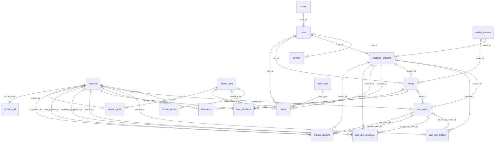
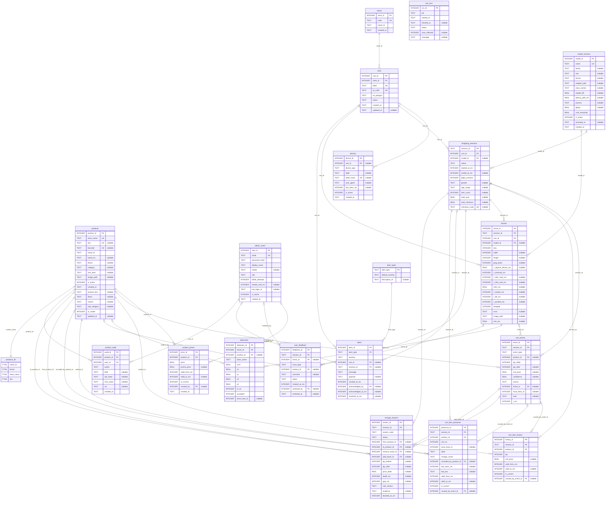

# ฐานข้อมูล SQLite

ไฟล์: `db/smartcart.db` (ไม่ commit) · สร้างจากศูนย์ด้วย

```powershell
npm install
npm run db:init   # รัน db/migrations/*.sql ที่ยังไม่เคยรัน บันทึกใน schema_migrations
npm run db:seed   # สินค้า 20 รายการ, ราคา, สาขา, รถเข็น 17 คัน, โมเดล 10 รุ่น, บัญชี admin
```

ทั้งสองคำสั่งรันซ้ำได้ (idempotent) และ server จะรัน seed ทุกครั้งที่ start

## กติกา

- ทุก connection ตั้ง `journal_mode=WAL`, `foreign_keys=ON`, `busy_timeout=5000` (`server/src/db/connection.js`)
- คอลัมน์ `*_ms` = epoch milliseconds จากนาฬิกา **server** ส่วน `created_at` / `updated_at` เป็นเวลา audit แบบ TEXT (UTC)
- `frames.t_capture_device_ms` เป็นนาฬิกามือถือ ใช้ดูอย่างเดียว ห้ามลบกับเวลา server; `frames.e2e_ms` วัดบนมือถือเครื่องเดียวกัน
- ห้ามแก้ไฟล์ migration ที่รันแล้ว (runner ตรวจ checksum) ให้เพิ่มไฟล์ใหม่แทน
- migration ที่ขึ้นต้นด้วย `-- requires: fts5_trigram` จะถูกข้ามถ้า SQLite ไม่รองรับ (การค้นหาจะ fallback เป็น `LIKE`) — better-sqlite3 ที่ใช้อยู่มากับ SQLite 3.53 รองรับแล้ว

## Migrations

| ไฟล์ | เนื้อหา |
| --- | --- |
| `001_init.sql` | `stores`, `carts`, `devices`, `products`, `product_prices` (SCD2), `model_versions`, `admin_users`, `shopping_sessions`, `cart_events`, `cart_item_history` (SCD2 จำนวนต่อสินค้า), `frames`, `detections`, `user_feedback`, `alert_types`, `alerts` และ view `v_product_abandon`, `v_cooccurrence`, `v_frame_latency` |
| `002_presence_reasons.sql` | attribute สินค้า (`product_line`, `flavor`, `variant`, `sub_category`, `in_model`), บาร์โค้ด unique, `frames.e2e_ms`, alert type ใหม่, `cart_item_presence` (SCD2 รายชิ้น), `change_reasons`, `product_audit`, `job_runs`, `v_change_reason_summary` |
| `003_products_fts.sql` | `products_fts` (FTS5 trigram สำหรับชื่อไทย) + trigger sync กับ `products` |

## การตัดสินใจที่ควรรู้

- **ไม่มีไฟล์ instruction ภาค 2 หัวข้อ 2.7 ในเครื่อง** — `001_init.sql` จึงออกแบบจากรายชื่อตารางในเอกสาร brief
- `alert_type` เก็บเป็นตาราง lookup (`alert_types`) แทน `CHECK` เพื่อให้ migration ถัดไปเพิ่มประเภทได้โดยไม่ต้อง rebuild ตาราง
- รถเข็น active ได้ครั้งละ 1 session (`ux_sessions_active_cart`), โมเดล active ได้ครั้งละ 1 รุ่น (`ux_model_active`)
- `products.in_model` คำนวณจาก `model.names` ของโมเดลที่ active (จาก `/health` ของ inference ถ้ารันอยู่ ไม่งั้นใช้ `model_versions.class_names`) — เปลี่ยน weights เป็น 20 คลาสแล้วไม่ต้องแก้โค้ด
- seed ไม่ทับสิ่งที่ admin แก้: สินค้าที่มีแถวใน `product_audit` และราคาที่มี `created_by` จะไม่ถูก CSV เขียนทับ; โมเดลที่ admin เลือกไว้ไม่ถูกเปลี่ยนกลับ; รหัสผ่านที่มีอยู่แล้วไม่ถูก reset
- `model_versions.weights_path` เป็น path สัมพัทธ์กับ `WEIGHTS_ROOT` (โฟลเดอร์ SNP แบบอ่านอย่างเดียว)

## ข้อมูลสินค้า (`db/seed/products_master.csv`)

ที่มา: `TMPPO/dataaaaaaaa.xlsx` (20 คลาส, ราคา, บาร์โค้ด) — ราคาใน `web/data.js` เป็นค่าตัวอย่างและใช้เฉพาะโหมด `?mock=1`

- `category` ตาม xlsx (`snack`, `care`, `instant_food`, `seasoning`) ส่วน `sub_category` ใช้ตัดสิน "เปลี่ยนแบรนด์": `chips`, `sweet_snack`, `nuts`, `instant_noodle`, `seasoning`, `baby_care`, `hand_soap`
- `kirei_refill_lavender` และ `kirei_refill_peach` ใน xlsx ใช้บาร์โค้ดเดียวกัน (`8850002035188`) จึงเว้นว่างไว้ทั้งคู่ ให้ admin ผูกบาร์โค้ดที่ถูกต้องผ่านหน้า "สินค้าและราคา"
- ชื่อไทยของ 9 คลาสใหม่และ `sub_category` ของ Babi Mild / Kirei เป็นร่าง รอผู้ใช้ยืนยัน

## ER diagram

สร้างจาก schema ของ `db/smartcart.db` จริง (`sqlite_master`, `pragma_table_info`, `pragma_foreign_key_list`) ด้วย `npm run db:erd` — รันใหม่ทุกครั้งหลังเพิ่ม migration
GitHub และ VS Code (ส่วนขยาย Markdown Preview Mermaid) แสดงภาพได้ทันที; ถ้าต้องการไฟล์ภาพสำหรับเล่ม ใช้ [mermaid.live](https://mermaid.live) หรือ `npx @mermaid-js/mermaid-cli` export เป็น SVG/PNG

หมายเหตุการอ่าน:
- `job_runs` ไม่มี FK จึงไม่อยู่ในภาพรวม (มีในรายละเอียดคอลัมน์)
- ไม่แสดง view (`v_*`) และตาราง `schema_migrations`
- unique แบบมีเงื่อนไขไม่ติดป้าย UK เพราะคอลัมน์ซ้ำได้: `shopping_sessions (cart_id) WHERE status='active'`, `product_prices (product_id) WHERE is_current=1`, `cart_item_history` / `cart_item_presence` แถวปัจจุบัน, `model_versions (is_active) WHERE is_active=1`

<!-- ERD:BEGIN (generated by npm run db:erd — do not edit by hand) -->
ที่มา: `db/smartcart.db` · migrations: `001_init.sql`, `002_presence_reasons.sql`, `003_products_fts.sql` · 20 ตาราง, 37 ความสัมพันธ์

สัญลักษณ์: `||--o{` = FK บังคับ (หนึ่งต่อศูนย์หรือหลาย) · `|o--o{` = FK ว่างได้ · ป้ายบนเส้น = คอลัมน์ FK ฝั่งลูก · PK / FK / UK = primary / foreign / unique key

### ภาพรวมความสัมพันธ์



### รายละเอียดคอลัมน์


<!-- ERD:END -->
